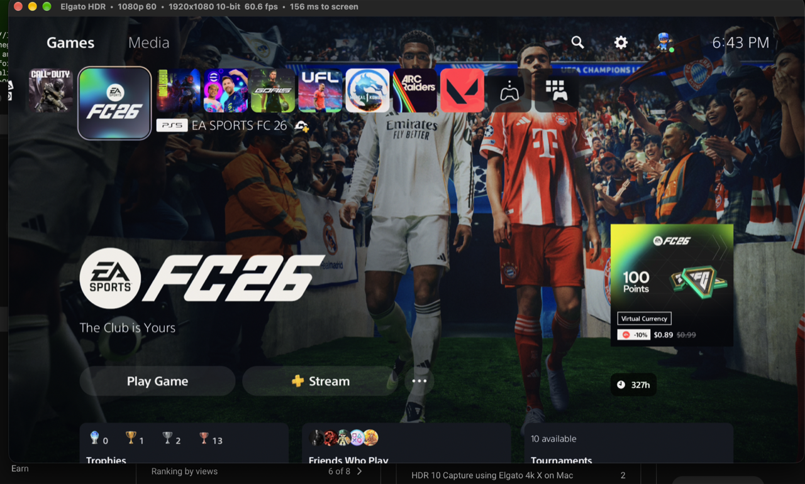

# Elgato HDR

A tiny native macOS app that captures the **10-bit HDR** signal from an **Elgato 4K X** and shows it live, in real HDR, and records it to a proper HDR10 file.

macOS hides this. The Elgato 4K X advertises a 10-bit `P010` video format over USB, but Apple's built-in webcam driver only ever exposes the 8-bit modes to apps like QuickTime, OBS, or anything using AVFoundation. So on a Mac you normally cannot see or record the capture card's HDR output at all, even though the same card does it fine on Windows. This project reaches the hidden 10-bit format directly and renders it the way macOS renders HDR video.

The whole thing is a few MB: a small native AppKit/SwiftUI app plus a C helper. No Electron, no third-party frameworks, no background services.



---

## What it does

- **Live HDR preview.** Displays the incoming 10-bit `P010` video as true HDR (BT.2020 / PQ by default) on any EDR-capable display, such as a Studio Display, XDR, or a MacBook Pro screen. Colors and highlights use the display's extended brightness range, exactly like HDR video playback.
- **Records HDR10.** Writes a 10-bit HEVC (`Main 10`) `.mov` with BT.2020 / PQ color, HDR10 mastering-display and content-light-level metadata, and AAC audio. The files play back as HDR in QuickTime, Finder, Final Cut, and DaVinci Resolve, and upload correctly to YouTube.
- **Captures audio too.** Pulls the card's USB audio (48 kHz stereo) alongside the video, plays it live with a mute toggle, and muxes it into the recording locked to the video clock.
- **Smooth, in-sync playback.** Frames are paced to the display's refresh so motion is even, and recorded files are stamped on a fixed frame grid so they play back perfectly steady regardless of USB timing jitter.
- **Facecam overlay, like a streamer.** Show any camera (built-in, Studio Display, iPhone Continuity Camera, USB webcam) in a window over the game. Drag it anywhere (it snaps to corners and edges), drag a corner or scroll to resize, and pick circle, rounded or square.
- **Layered recordings.** Game, camera and microphone are recorded as separate files that start at exactly the same instant, so nothing is baked in. Change the layout, framing, volumes and sync after the fact.
- **One recording, every format.** The built-in editor lays out a widescreen **16:9** cut and a vertical **9:16** cut (for Shorts, Reels and TikTok) independently, and exports both in one go, as HDR10 HEVC or SDR H.264.
- **All the card's HDR modes.** 4K30, 1440p60, ultrawide 2560×1080 60, 1080p 120/60/30, and 720p 120, every one of them 10-bit.

### Color modes

| Mode | Use it for |
|------|------------|
| **HDR10 (PQ, BT.2020)** — default | An HDR source (HDR game console, HDR camera) |
| **HLG (BT.2020)** | An HLG source |
| **SDR (BT.709)** | A standard-dynamic-range source, still captured at 10-bit |

---

## Requirements

- macOS 14 or newer (built and tested on Apple Silicon).
- An **Elgato 4K X** capture card. Other Elgato cards that expose a `P010` UVC format may work but are untested.
- An HDR / EDR-capable display to see the HDR preview (SDR displays still work, just tone-mapped by macOS).
- For building from source: **Xcode Command Line Tools** and **[Homebrew](https://brew.sh)**.

---

## Install

### Option A — download a release

1. Grab the latest `ElgatoHDR-<version>.zip` from the [Releases](../../releases) page and unzip it.
2. Move **Elgato HDR.app** to `/Applications`.
3. The app is signed only for local use, not notarized by Apple, so the first launch is blocked by Gatekeeper. Open it once with **right-click → Open**, then click **Open** in the dialog. After that it launches normally. (Command-line equivalent: `xattr -dr com.apple.quarantine "/Applications/Elgato HDR.app"`.)

### Option B — build from source

```sh
git clone <this-repo-url> elgato-hdr
cd elgato-hdr
brew install libusb          # the helper links against libusb
xcode-select --install       # if you don't already have the CLT
./build.sh                   # produces dist/Elgato HDR.app
open "dist/Elgato HDR.app"
```

---

## Using it

1. Plug an HDR source into the Elgato 4K X and connect the card to your Mac.
2. Launch **Elgato HDR**. The first launch shows one macOS **administrator prompt** — this is required (see [How it works](#how-it-works)). Enter your password and the live picture appears.
3. Pick your source resolution from the **Input** menu, and the matching **Color** mode.
4. Optional: press **⌘K** to show your camera, and pick a microphone in the **Camera** menu. Drag the camera where you want it.
5. Press **⌘R** to start and stop recording. Each recording is saved as its own folder in `~/Movies/Elgato HDR/`.
6. Press **⌘O** to open the **Recordings** library. Double-click a recording to edit and export it.

### Editing and exporting

The editor shows the composite exactly as it will be exported, in HDR when exporting HDR.

- Switch between **16:9** and **9:16** in the toolbar. Each canvas keeps its own layout: **Camera overlay**, **Split** (camera on top, gameplay below, the usual vertical-clip layout), **Game only** or **Camera only**.
- Drag the camera on the preview to move it and drag its corners to resize it. Drag the game to reframe the crop, and drag the split divider to change the proportions.
- Trim with the yellow handles or **I** / **O** at the playhead. The timeline shows one lane per layer.
- **Audio & Sync** sets the game and mic volumes and nudges the camera or mic in milliseconds, if your voice runs ahead of the gameplay because of the card's delay.
- **Export** renders the canvases you tick at 1080p or 4K, at the source frame rate, 60 or 30. Exports go into the recording's `Exports` folder.

A recording folder contains:

```
game.mov       10-bit HEVC HDR video + game audio (the card's signal, untouched)
camera.mov     H.264 facecam (only if the camera was on)
mic.m4a        AAC microphone (only if a mic was selected)
project.json   Layouts, trim, volumes and sync; every edit is non-destructive
thumbnail.jpg  Library preview
Exports/       Rendered videos
```

### Menus and shortcuts

| Menu | Item | Shortcut |
|------|------|----------|
| Input | 4K 30 … 720p 120 | ⌘1 – ⌘7 |
| Color | HDR10 / HLG / SDR | — |
| Audio | Mute | ⌘M |
| Camera | Show / Hide Camera | ⌘K |
| Camera | Bigger / Smaller | ⌘= / ⌘- |
| Camera | Camera, microphone, shape, position, mirror, border, shadow | — (also on right-click in the live view) |
| Record | Start / Stop Recording | ⌘R |
| Record | Recordings Library | ⌘O |
| Record | Show Recordings in Finder | — |
| View | Show Live View | ⌘0 |
| View | Toggle Full Screen | ⌘F |
| View | Smooth / Game / Lowest Latency | ⌘J / ⌘G / ⌘L |
| View | Reconnect | ⇧⌘R |

The **View** menu picks how frames reach the screen. None of these affect recordings.

| Setting | What it does | Measured delay, 1440p60 on a 120 Hz MacBook Pro |
|---------|--------------|------|
| **Smooth** (default) | Holds each frame briefly so motion is perfectly even | ~48 ms |
| **Game** | Shows each frame as soon as it arrives, synced to the display refresh (no tearing) | ~22 ms |
| **Lowest Latency** | Shows each frame immediately without waiting for the refresh; can tear in full screen | ~5 ms |

Delays are from a frame finishing its USB transfer to it being shown, as reported by macOS; the card's own processing comes on top. For playing, use **1440p 60** or **1080p 120** with Game: 4K 30 is the only 4K HDR mode the USB link has bandwidth for, so a 4K60 source is captured at half its frame rate.

---

## How it works

Three moving parts:

1. **`tools/uvc_capture.c` — a small root helper.** Using [libusb](https://libusb.info), it detaches Apple's USB video driver from the card and talks the USB Video Class protocol directly. It negotiates the hidden `P010` format (format index 7), reads the video off the card's bulk endpoint, reassembles frames, and also captures the card's USB audio. Detaching the kernel driver requires root on macOS, which is why the app asks for your password once and launches the helper with administrator privileges. The helper runs as a small server, stays alive across resolution changes, and exits on its own about 20 seconds after the app quits, handing the card back to macOS so other apps see it again.

2. **Shared-memory hand-off.** The helper writes each frame straight into a shared-memory ring the app reads with zero copies. Only tiny header messages travel over a Unix socket. This keeps 4K frames off the CPU's memory-copy path entirely.

3. **`app/main.swift` — the AppKit app.** A Metal shader converts the 10-bit `P010` planes to RGB directly from shared memory and draws into a PQ / HLG / BT.709 layer with the right EDR metadata, so macOS lights it up as HDR. A display-link scheduler paces frames onto the refresh grid for even motion. Audio plays through AVAudioEngine on a dedicated thread. Recording uses the hardware HEVC `Main 10` encoder via AVAssetWriter, stamping video on a fixed frame grid and gently slewing audio to keep A/V sync locked.

Measured latency from a frame arriving over USB to it appearing on screen is a few milliseconds of app work on top of the card's own processing; the app favors smooth, in-sync output over shaving off the last milliseconds.

### A note on HDR metadata

The recorded files carry standard HDR10 mastering metadata (1000-nit peak, P3 primaries). The Elgato does not pass the source's original HDMI HDR metadata over USB, so these are sensible defaults rather than the exact values the source mastered to. Players use them only as a tone-mapping hint; the actual 10-bit pixels are untouched, so the picture is correct either way.

---

## Project layout

```
app/main.swift        The macOS app: capture client, live renderer, audio, game recorder, menus
app/Camera.swift      Camera + microphone capture and their layer writers (shared host clock)
app/Compositor.swift  Metal compositor shared by the live view, editor preview and export (PQ/HLG/SDR)
app/Project.swift     Project model, layout math, AVComposition builder, exporter, library store
app/LibraryUI.swift   Recordings library and editor (SwiftUI)
app/Info.plist        App bundle metadata
tools/uvc_capture.c   Root helper: libusb UVC bypass, P010 capture, USB audio, shm server
tools/*.c             USB descriptor dumps used while reverse-engineering the card
tools/modetest.py     Test client that sweeps every capture mode
build.sh              Builds dist/Elgato HDR.app (bundles the helper and libusb)
package.sh            Builds and zips a distributable release
```

---

## Contributing

Contributions are welcome. Bug reports, new capture-device support, and improvements to latency, color, or recording are all useful.

- Open an issue describing what you see, ideally with the card model and macOS version.
- For code changes, keep the app small and dependency-free, and test that live view, audio, and recording all still work before opening a pull request.
- Descriptor dumps from other Elgato (or other-brand) capture cards that expose a 10-bit UVC format are especially welcome — they are how support for more devices gets added.

---

## License

[MIT](LICENSE). This is an independent project and is not affiliated with or endorsed by Elgato or Corsair.
